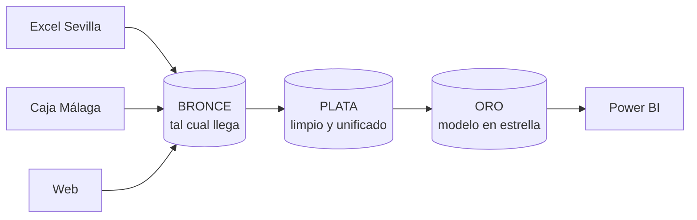
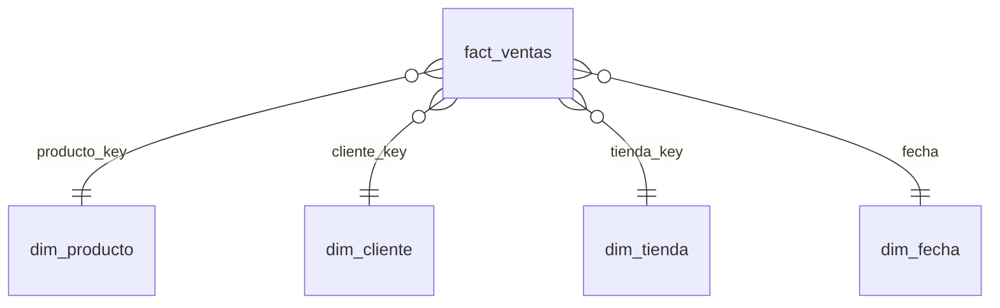

# Episodio 3 · Imagina que tu empresa necesita un Data Warehouse

Un almacén de datos en miniatura, de verdad funcional, con la tienda de bicis **Ciclos del Sur** y tres sistemas que no se hablan entre sí:

| Sistema | Fichero (bronce) | Sus manías |
|---|---|---|
| Tienda de Sevilla (Excel) | `sevilla_excel.csv` | separador `;`, fecha `dd/mm/aaaa`, decimales con coma |
| Tienda de Málaga (programa de caja) | `malaga_caja.csv` | fecha americana `mm/dd/aaaa`, código `P-013`, tienda `MLG`, descuento en %, **un día exportado dos veces** |
| Web | `web_pedidos.csv` | columnas en inglés, fecha con hora ISO, códigos en minúscula (`p013`) |
| Maestro de productos | `productos.csv` | **P013 repetido** (el error del episodio 1) |

## Las tres capas



- **Bronce** (`sql/01_bronce.sql`): se cargan los CSV sin tocar nada, todo como texto. Si algo sale mal, siempre puedes volver al original.
- **Plata** (`sql/02_plata.sql`): fechas al mismo formato, `P-013` y `p013` pasan a `P013`, `MLG` pasa a `Málaga`, se quitan las líneas duplicadas y el producto repetido.
- **Oro** (`sql/03_oro.sql`): modelo en estrella con claves propias del almacén.



- **Pruebas** (`sql/04_pruebas.sql`): líneas duplicadas, ventas sin producto, sin tienda o fuera del calendario, importes negativos. Si alguna falla, `run.py` termina con error y el dato no debería llegar al informe.

## Cómo ejecutarlo

```bash
pip install duckdb
python run.py
```

Salida esperada (resumen):

```
Pruebas
  lineas_duplicadas                PASA
  ventas_sin_producto              PASA
  ...
Ventas por tienda (una sola versión de la verdad)
  Sevilla        654,875.54 €
  Málaga         396,534.31 €
  Web            244,934.71 €
  TOTAL        1,296,344.55 €
```

El total coincide con la cifra corregida del episodio 1. Se crea un fichero `almacen.duckdb` que puedes abrir desde Power BI (conector ODBC de DuckDB) o con cualquier cliente SQL.

## Pruébalo tú

1. Comenta el `QUALIFY` de `plata.ventas` y vuelve a ejecutar: verás la prueba `lineas_duplicadas` fallar.
2. Comenta el `QUALIFY` de `plata.productos`: el total sube, como en el episodio 1.
3. Añade una cuarta fuente (por ejemplo, el taller) siguiendo el mismo patrón.

## Equivalencias en el mundo real

| Aquí | En una empresa |
|---|---|
| DuckDB en tu portátil | Microsoft Fabric, Snowflake, BigQuery, Databricks, Redshift |
| Ficheros `.sql` por capa | dbt, notebooks, procedimientos |
| `run.py` | un orquestador (Data Factory, Airflow, pipelines de Fabric) |
| `04_pruebas.sql` | tests de dbt, Great Expectations |
