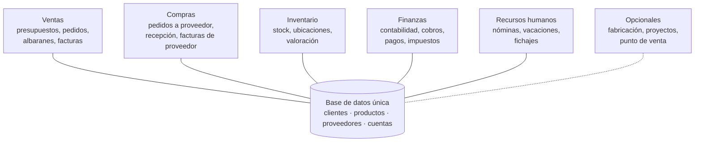
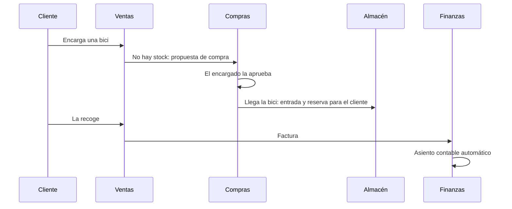

# Episodio 4 · Imagina que te cuentan qué es un ERP

Un mapa para entender qué hay dentro de un ERP, cómo viaja una venta por él y qué revisar antes de implantarlo. Todo con la tienda de bicis **Ciclos del Sur** (inventada).

## 1. Mapa de módulos

Un ERP es **un solo sistema con una sola base de datos**. Los módulos no son programas separados: comparten clientes, productos, proveedores y cuentas.

## 2. Una bici, de principio a fin

Cada documento sabe de dónde viene (**trazabilidad**): factura ← albarán ← pedido ← quién, cuándo y a qué precio.

## 3. ¿Qué tipo de ERP?

| Tamaño | Ejemplos que se mencionan en el vídeo |
|---|---|
| Gran empresa | SAP S/4HANA, Oracle, Microsoft Dynamics 365 Finance |
| Pyme | Microsoft Dynamics 365 Business Central, SAP Business One, Odoo, Sage, A3 |
| Autónomo / muy pequeña | Programas de facturación en la nube que crecen por módulos |

Antes de firmar, pregunta cómo puedes **sacar tus datos** si un día cambias de proveedor.

## 4. Checklist de implantación

**Procesos (error 1: personalizarlo todo)**
- [ ] Lista de procesos: ¿cuáles son ventaja de verdad y cuáles costumbre?
- [ ] Regla 80/20: si el estándar cubre el 80 %, adáptate en el resto.
- [ ] Cada personalización con dueño, motivo y coste en cada actualización.

**Datos (error 2: migrar los datos sucios)**
- [ ] Maestros revisados: clientes, productos y proveedores sin duplicados ni códigos dobles.
- [ ] Decidido qué se migra y qué se archiva, con alguien del negocio que da el visto bueno a cada tabla.
- [ ] Al menos dos ensayos de migración antes del día real.
- [ ] Plan para lo que está a medias: pedidos pendientes, facturas sin cobrar y stock contado ese día.
- [ ] Arranque a principio de mes, después de contar el almacén.

**Personas (error 3: tratarlo como un proyecto de informática)**
- [ ] Un usuario clave por área.
- [ ] Formación que explique el porqué, no solo el cómo.
- [ ] Después del arranque: buscar Excels paralelos y preguntar por qué existen.

## 5. ERP y datos

- El ERP es la fuente principal del almacén de datos del [episodio 3](../03-data-warehouse).
- Para conectarlo a Power BI o al almacén, usa **las vistas o interfaces oficiales** del fabricante, no las tablas internas: cambian con cada actualización.
